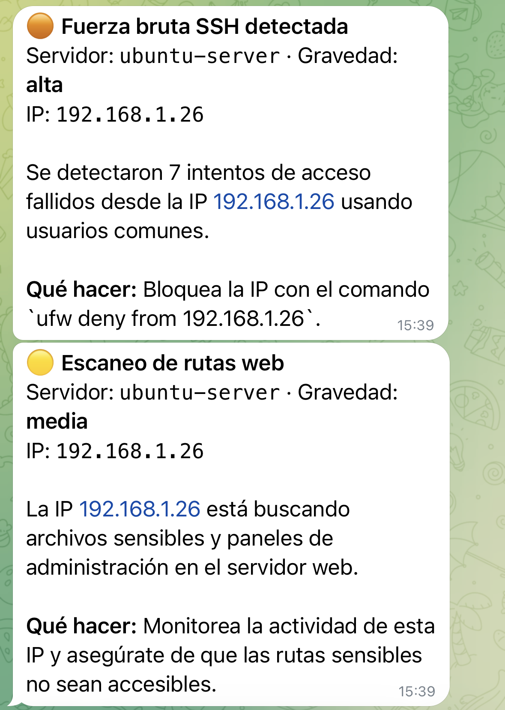

# ai-log-analyzer

Analizador de logs para un servidor Ubuntu que usa un modelo de IA en local para detectar incidencias y avisarme por Telegram.

Lo hice para practicar administración de Linux con algo útil: los servidores guardan en los logs todo lo que pasa (intentos de acceso, errores de la web, servicios que se caen), pero nadie se los lee. Este script los revisa cada 5 minutos, le pasa lo importante al modelo y me llega un aviso con lo que pasa y qué hacer.

El modelo corre en mi PC con LM Studio, así que los logs no salen de mi red. Esto es importante porque los logs tienen IPs y nombres de usuario.

## Cómo funciona

```
 VM Ubuntu Server                                         Mi PC (Windows)
┌─────────────────────────────────────────┐            ┌───────────────────┐
│ /var/log/auth.log   (SSH, sudo)         │            │ LM Studio         │
│ /var/log/nginx/*    (web)               │──eventos──▶│ Gemma 4 (GPU)     │
│ /var/log/mysql/*    (base de datos)     │◀─análisis──│ API :1234         │
│ disco y servicios   (systemctl)         │            └───────────────────┘
│                                         │
│ analyzer (Python, timer cada 5 min)     │──alerta──▶ Telegram
│        │                                │
│        ▼                                │
│ MySQL: tabla incidents                  │
└─────────────────────────────────────────┘
```

1. **Lee solo las líneas nuevas** de cada log (guarda por dónde iba en `state.json` y detecta si logrotate ha rotado el archivo).
2. **Agrupa los eventos** con expresiones regulares: por ejemplo, "30 contraseñas fallidas desde la IP X probando el usuario root". Así al modelo no le llegan miles de líneas, solo un resumen.
3. **El modelo los analiza** y devuelve en JSON la gravedad, una explicación y qué hacer.
4. **Guarda la incidencia en MySQL** y, si es de gravedad media o más, **avisa por Telegram**. La misma alerta no se repite durante una hora.
5. Cada mañana a las 9:00 envía un **informe** con las incidencias del último día.

### Qué detecta

| Origen | Detección |
|---|---|
| SSH | Fuerza bruta (muchos fallos desde una IP), acceso correcto después de muchos fallos |
| sudo | Contraseñas incorrectas |
| Nginx | Muchos errores 5xx, escaneos de rutas típicas (`/wp-login.php`, `/.env`, `/phpmyadmin`...), errores del servidor |
| MySQL | Errores y accesos denegados |
| Sistema | Disco por encima del 85 %, servicios caídos (ssh, nginx, mysql) |

### Si la IA falla

- Si LM Studio no responde, las incidencias se clasifican con **reglas fijas**, para no perder alertas.
- Hay una **gravedad mínima** que la IA no puede bajar: un acceso correcto tras muchos fallos siempre es *crítica* y un servicio caído siempre es *alta*.

## Instalación

Probado en Ubuntu Server 24.04 en VirtualBox (red en adaptador puente) con LM Studio en Windows.

**En el PC con LM Studio:** cargar el modelo y activar *Developer → Settings → Serve on Local Network*.

**En el servidor Ubuntu:**

```bash
sudo apt install -y openssh-server nginx mysql-server python3-venv git
git clone https://github.com/juanvitale123/ai-log-analyzer.git
cd ai-log-analyzer

sudo ./scripts/install.sh                 # copia a /opt, crea el usuario y el venv
nano sql/schema.sql                       # cambiar las contraseñas
sudo mysql < sql/schema.sql               # base de datos y tabla
sudo nano /opt/ai-log-analyzer/.env       # IP de LM Studio, MySQL y Telegram

sudo systemctl start ai-log-analyzer      # prueba manual
journalctl -u ai-log-analyzer -n 30
sudo systemctl enable --now ai-log-analyzer.timer ai-log-report.timer
```

El servicio corre con un usuario de sistema propio (`loganalyzer`) en el grupo `adm`, que es el que puede leer `/var/log`. No hace falta ejecutarlo como root. El `.env` tiene permisos `600` porque lleva el token y las contraseñas.

## Probarlo

`scripts/simulate_attack.sh` lanza intentos de SSH con contraseñas incorrectas y un escaneo web contra la VM (solo para usarlo contra tu propia máquina de pruebas):

```bash
sudo apt install -y sshpass
./scripts/simulate_attack.sh 192.168.1.50
```

Para ver qué detecta sin guardar ni enviar nada:

```bash
cd /opt/ai-log-analyzer
sudo -u loganalyzer venv/bin/python -m analyzer.main --dry-run
```

## Capturas

Alertas en Telegram después de simular un ataque de fuerza bruta SSH y un escaneo web contra la VM:



## Estructura

```
analyzer/
  collectors.py   lectura de logs y comprobaciones del sistema
  llm.py          llamada al modelo local y reglas de respaldo
  storage.py      MySQL
  notifier.py     mensajes de Telegram
  main.py         punto de entrada (--dry-run, --report)
deploy/           servicios y timers de systemd
sql/schema.sql    base de datos, usuarios y tabla
scripts/          instalación y simulación de ataque
```

## Lo que aprendí

- Dónde guarda Ubuntu cada log, sus permisos (grupo `adm`) y cómo funciona logrotate.
- Que mandarle al modelo los logs en bruto no funciona: es lento y se inventa cosas. Agrupar antes con regex y pedirle una respuesta en JSON con un esquema fijo funciona mucho mejor.
- Usar timers de systemd en lugar de cron, y ejecutar servicios con un usuario sin privilegios.
- Que la IA no debe tener la última palabra en lo crítico, por eso existen las reglas mínimas.

## Pendiente

- Panel en Grafana leyendo de MySQL.
- Empaquetarlo con Docker Compose.
- Opción para bloquear una IP con `ufw` o Fail2ban, siempre con aprobación manual.
